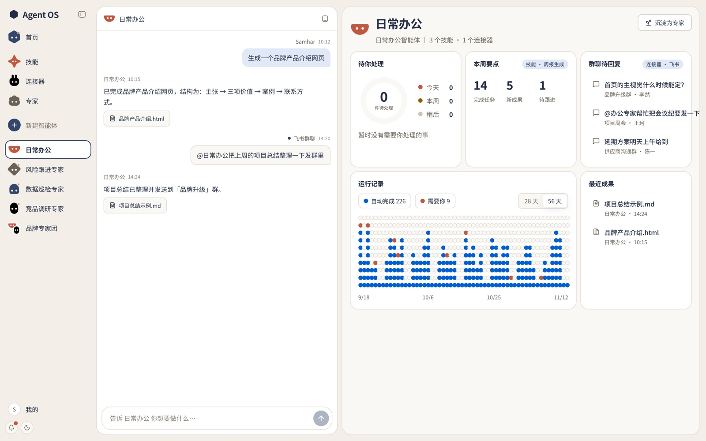

# AgentOS

**面向企业的智能体平台：让企业的智能体成为长期存在、承担职责的专家。**



- [为什么做 AgentOS](#为什么做-agentos)
- [设计灵感：Grok Bot](#设计灵感grok-bot)
- [AgentOS 怎么设计](#agentos-怎么设计)
- [开发时守住的几条线](#开发时守住的几条线)
- [当前状态与本地运行](#当前状态与本地运行)
- [文档导航](#文档导航)

---

## 为什么做 AgentOS

### 背景

Agent 架构一路演进，为了把企业的任务做好，逐渐出现了**技能**（会什么）、**连接器**（能连到哪些系统）、**专家**（带着方法论的岗位角色）这些概念。它们正在成为企业沉淀经验和方法论的主要载体。

### 企业现在遇到的问题

| 问题 | 现状 |
|---|---|
| **分散** | 技能、连接器、提示词散落在每个员工自己的工具和对话里，公司不知道有哪些 |
| **难复用** | 一个人调好的做法，别人拿不到；换个人、换个部门，就要从头再来 |
| **难治理** | 谁在用哪个连接器、查了什么数据、凭证放在哪、哪个技能在出错，都看不见 |
| **留不下** | 对话式 Agent 用完即走，经验留在一次次对话里，变不成公司的资产 |

### AgentOS 的回答

**不再以对话为单位，而是以智能体为基本单位。** 一个智能体就是一个长期存在的岗位：

1. **长期存在**：有自己的记忆、长期职责（Routine）和工作台（面板）。明天回来，还是同一个智能体。
2. **能力统一治理**：技能和连接器在组织层统一管理，按智能体授权；每次调用都有权限校验和审计记录。
3. **沉淀为资产**：用顺手的智能体沉淀为专家，审批后进入公司的 Agent Market，全公司都能招募。

---

## 设计灵感：Grok Bot

[Grok Bot](https://x.ai/news/designing-grok-bot) 是 SpaceXAI（原 xAI）和 Cursor 推出的「常驻 AI 同事」：每个 Bot 有固定岗位和自己的记忆，同一用户的 Bot 共用一台云电脑，用户离线时也在干活，底座是 Cursor 的平台。

| | Grok Bot 的做法 | AgentOS |
|---|---|---|
| 基本单位 | Bot 是主对象，不是对话 | ✅ 沿用：智能体是唯一的基本单位 |
| 记忆 | 按 Bot 隔离，群聊共享上下文 | ✅ 沿用 |
| 长期职责 | Routine：定时或事件触发 | ✅ 沿用 |
| 技能、连接器 | 账号内全部共享 | 🔀 组织共享，**按智能体授权** |
| 执行环境 | 每用户一台常驻云电脑 | 🔀 **不做虚拟机**，按任务选执行路径 |
| 交互 | 对话为主，回复里带卡片 | 🔀 **左对话、右面板**，面板可以直接操作 |
| 隔离 | 同一用户的 Bot 之间不隔离 | 🔀 智能体之间隔离 |
| 沉淀 | 技能可以存下来复用 | ➕ **智能体沉淀为专家**，进公司市场 |
| 底座 | Cursor | KodaX |

✅ 沿用　🔀 改造　➕ 新增。完整解析和 9 张结构图见 **[Grok Bot 结构解析](docs/GROK_BOT_ANALYSIS.md)**。

---

## AgentOS 怎么设计

### 核心概念

| 名称 | 是什么 |
|---|---|
| **智能体** | 最小单位。一段对话就是一个智能体：有身份、记忆、面板和工作区，是在干活的实例 |
| **智能体群** | 多个智能体协作，本身也作为一个智能体出现 |
| **专家 / 专家团** | 智能体 / 智能体群沉淀出来的**定义包**：提示词 + 技能和连接器清单 + 面板模板，不带记忆和环境 |
| **技能** | 智能体「会什么」，统一放在 SkillHub |
| **连接器** | 智能体「能连到哪些系统」（MCP），统一放在 MCPHub，凭证由 Vault 托管 |
| **企业效能管理智能体** | 主智能体，就是首页：汇总全部智能体的状态，也是治理入口 |
| **专家管理 / 技能管理 / 连接器管理** | 三个系统智能体，在对话里完成管理操作 |
| **Agent Market** | 公司级市场：专家、专家团、技能、连接器审批后上架，全公司复用 |

一句话记住智能体和专家的关系：**智能体 = 专家（定义）+ 记忆 + 环境。**

### 整体架构

```text
┌─ 1 交互层：网页端，面向企业 ─────────────────────────────────────────────┐
│ ┌───────────────┐  ┌───────────────┐  ┌──────────────┐  ┌──────────────┐ │
│ │   左：对话    │  │    Widget     │  │   通知中心   │  │ Agent Market │ │
│ │   右：面板    │  │    组件库     │  │   审批卡片   │  │   企业市场   │ │
│ └───────────────┘  └───────────────┘  └──────────────┘  └──────────────┘ │
└──────────────────────────────────────────────────────────────────────────┘
                                     │
                                     ▼
┌─ 2 智能体层：每个智能体各自拥有 ─────────────────────────────────────────┐
│ ┌───────────┐  ┌───────────┐  ┌───────────┐  ┌───────────┐  ┌──────────┐ │
│ │   身份    │  │   记忆    │  │ Routines  │  │   面板    │  │   托管   │ │
│ │  提示词   │  │ 对话历史  │  │ 长期职责  │  │ Dashboard │  │  工作区  │ │
│ └───────────┘  └───────────┘  └───────────┘  └───────────┘  └──────────┘ │
└──────────────────────────────────────────────────────────────────────────┘
                                     │ 按授权调用共享能力
                                     ▼
┌─ 3 能力层：组织共享，按智能体授权 ───────────────────────────────────────┐
│ ┌───────────────┐  ┌───────────────┐  ┌──────────────┐  ┌──────────────┐ │
│ │   SkillHub    │  │    MCPHub     │  │    Vault     │  │    专家库    │ │
│ │    技能库     │  │   连接器库    │  │   凭证托管   │  │    可招募    │ │
│ └───────────────┘  └───────────────┘  └──────────────┘  └──────────────┘ │
└──────────────────────────────────────────────────────────────────────────┘
                                     │ 按任务类型执行
                                     ▼
┌─ 4 执行层：不做虚拟机 ───────────────────────────────────────────────────┐
│ ┌───────────────┐  ┌───────────────┐  ┌──────────────┐  ┌──────────────┐ │
│ │   MCP 网关    │  │   临时沙箱    │  │  KodaX CLI   │  │ KodaX Space  │ │
│ │  调企业系统   │  │   用完销毁    │  │   编码运维   │  │   员工电脑   │ │
│ └───────────────┘  └───────────────┘  └──────────────┘  └──────────────┘ │
└──────────────────────────────────────────────────────────────────────────┘
                                     │ 全部跑在
                                     ▼
┌─ 5 KodaX 底座 ───────────────────────────────────────────────────────────┐
│ ┌───────────────┐  ┌───────────────┐  ┌──────────────┐  ┌──────────────┐ │
│ │     KodaX     │  │     模型      │  │  技能、MCP   │  │    Trace     │ │
│ │    runtime    │  │   接入路由    │  │   运行机制   │  │   运行记录   │ │
│ └───────────────┘  └───────────────┘  └──────────────┘  └──────────────┘ │
└──────────────────────────────────────────────────────────────────────────┘

┌─ 横切：企业级治理 ───────────────────────────────────────────────────────┐
│  权限 / 审批 / 脱敏 / 审计 / 版本 / 用量：由企业效能管理智能体统一查看   │
└──────────────────────────────────────────────────────────────────────────┘
```

### 六个关键设计决策

1. **智能体是唯一的基本单位。** 不再区分项目、会话、任务，对话历史和记忆都属于智能体。
2. **能力组织共享，按智能体授权。** 每个智能体只拿到被授权的技能和连接器；KodaX 只负责「给它什么就用什么」，AgentOS 负责「决定给每个智能体什么」。
3. **面板：定义归智能体，渲染归交互层。** 智能体只生成声明式的 Dashboard Spec，由统一的 Widget 组件库渲染。Widget 分展示型和操作型；操作型可以直接调用连接器（查询、登记类，结果确定），也可以交给智能体推理（分析类）。两条路的结果都写进同一条对话时间线。
4. **执行层不做虚拟机。** 任务按类型走四条路径之一：连接器（主路径）、临时沙箱（按任务拉起、用完销毁）、KodaX CLI（编码运维）、KodaX Space（员工电脑，需要本人授权）。每个智能体有一份托管工作区，存放文件、产物和运行记录。
5. **专家是定义包，招募就是新建实例。** 沉淀时去掉记忆和环境，只留定义；招募专家得到一个新智能体，记忆从空开始，连接器由使用者重新授权。
6. **治理是一等公民。** 权限、审批、脱敏、审计、版本、用量，由企业效能管理智能体统一查看。

### 一个智能体的一生

```text
┌──────────────────────────────────────────────────────────────────────────┐
│                                新建智能体                                │
└──────────────────────────────────────────────────────────────────────────┘
                                     │ 两种起点
                   ┌─────────────────┴──────────────────┐
                   ▼                                    ▼
  ┌─ 从空白开始 ────────────────────┐  ┌─ 招募一个专家 ──────────────────┐
  │ 只起名、选头像                  │  │ 用专家的定义新建实例            │
  │ 在工作中自己长出能力            │  │ 记忆从空开始                    │
  └─────────────────────────────────┘  └─────────────────────────────────┘
                   └─────────────────┬──────────────────┘
                                     │
                                     ▼
┌─ 干活，长出能力 ─────────────────────────────────────────────────────────┐
│ 交代任务 > 按需申请技能和连接器 > 面板随能力变化                         │
│ 跑通的做法存为技能，长期要做的设成 Routine                               │
└──────────────────────────────────────────────────────────────────────────┘
                                     │
                                     ▼
┌─ 沉淀为专家 ─────────────────────────────────────────────────────────────┐
│ 去掉记忆和环境，只留定义：提示词、技能和连接器清单、面板模板             │
└──────────────────────────────────────────────────────────────────────────┘
                                     │
                                     ▼
┌─ 发布 ───────────────────────────────────────────────────────────────────┐
│ 审批通过后上架公司 Agent Market，全公司都能招募                          │
└──────────────────────────────────────────────────────────────────────────┘
```

别人从市场招募这个专家，就回到最上面的「招募一个专家」，开始一个新实例。

每一步的流程图，以及面板交互、智能体群、安全边界的细节，见 **[AgentOS 结构解析](docs/AGENTOS_STRUCTURE.md)**。

---

## 开发时守住的几条线

- **不 fork KodaX。** 启动智能体时由 AgentOS 显式注入它被授权的技能和连接器，不让 KodaX 扫描全局配置。
- **智能体不生成界面代码。** 面板只产出 Dashboard Spec（JSON），由固定的 Widget 组件库渲染。
- **凭证不进智能体，也不进沙箱。** 连接器调用一律经过 MCP 网关，由网关从 Vault 取凭证、代为请求。
- **所有调用走统一接口，并留下记录。** 不论是技能、连接器还是沙箱，都通过同一个执行接口调用，结果写回运行记录，供治理和回放使用。
- **面板操作和对话写同一条时间线。** 用户在面板上做的事，智能体要知道。
- **专家包里不能有记忆和凭证。** 沉淀和发布时必须校验。

---

## 当前状态与本地运行

v0.3 是**前端交互原型**：默认页面是智能体工作空间（代码在 `src/components/botos/`），另有 Agent Market（`?view=market`）和头像样稿（`?view=avatars`）。智能体回复是模拟的，数据保存在浏览器本地，还没有接入模型、真实 MCP 和后端。

需要 Node.js 22.18.0 及以上，推荐 Node.js 24。

```bash
npm install
npm run dev
```

默认地址是 [http://localhost:5173](http://localhost:5173)。检查命令：

```bash
npm run lint:workspace
npm test
npm run build
```

---

## 文档导航

| 文档 | 内容 |
|---|---|
| [AgentOS 结构解析](docs/AGENTOS_STRUCTURE.md) | **从这里开始**：12 张结构图，讲清楚每一层、每个流程怎么设计 |
| [Grok Bot 结构解析](docs/GROK_BOT_ANALYSIS.md) | 设计灵感的完整拆解和来源 |
| [产品设计 v0.3](docs/PRODUCT_DESIGN_v0.3.md) | v0.3 原型的对象模型、界面结构和 Dashboard Spec |
| [产品架构与流程](docs/AGENTOS_ARCHITECTURE.md) | 生命周期、Agent Market 与第三方接入 |
