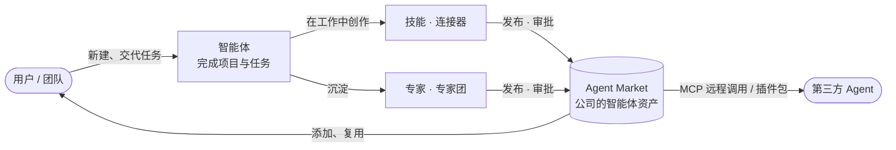
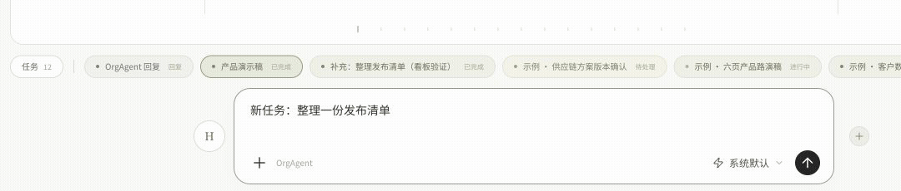

# AgentOS

**智能体管理平台。**

- **用智能体完成项目和任务**：新建一个智能体，起个名字、选个头像就能开始；它会主动问你先做什么。
- **用智能体创作技能和连接器**：智能体在工作中自主添加、移除需要的技能（会什么）和连接器（连到哪些系统）；也可以在对话里直接让「技能」「连接器」帮你创建。
- **沉淀为专家、专家团**：用得顺手的智能体沉淀为专家，协作的智能体群沉淀为专家团。
- **形成公司资产和智能体市场**：专家、专家团、技能、连接器发布到企业的 Agent Market（需审批），全公司复用，也可以被第三方 Agent 通过 MCP 调用。



完整的架构、概念、生命周期和关键流程图见 **[AgentOS 产品架构与流程](docs/AGENTOS_ARCHITECTURE.md)**，设计细节见 [产品设计 v0.3](docs/PRODUCT_DESIGN_v0.3.md)。

### 当前状态

v0.3 是**前端交互原型**：默认页面是智能体工作空间（代码在 `src/components/botos/`），另有 Agent Market（`?view=market`）和头像样稿（`?view=avatars`）。智能体回复为模拟，数据保存在浏览器本地，尚未接入模型、真实 MCP 与后端。

```bash
npm install
npm run dev
```

---

## v0.2 工作空间（历史版本）

> 以下内容描述 v0.2「统一输入 → 任务 → 成果」工作空间，可通过 `?view=v02` 打开，仅供对照。

当前版本为 **v0.2.0 前端交互原型**。默认直接打开 **Home 工作台**，内置品牌升级、供应链风控和数据中台等示例。无需账号、API Key 或后端即可体验。任务执行、模型选择、来源接入均为本地演示，尚未连接真实 Agent 服务。



### 当前可以体验什么

| 入口 | 交互与内容 |
| --- | --- |
| Home 工作台 | 任务总数、进行中工作、成果与来源概览；项目进度和最近成果 |
| Home 资源 | 技能、插件与知识库的独立资源页，支持搜索、详情和相关成果浏览 |
| 项目 | 固定示例项目与默认项目；按「待确认 / 进行中 / 已完成」查看任务 |
| 任务记录 | 汇集文本输入和示例来源消息；搜索、打开任务、停止和继续 |
| 成果展示 | 文档阅读、演示稿翻页、网页尺寸预览和关系图谱；左右切换任务与成果 |
| 输入来源 | 添加飞书群聊、GitHub 或其他 IM 的示例配置，启停来源、导入示例需求 |
| 模型偏好 | 系统默认、GPT-4o、Claude Sonnet 4.6、DeepSeek Chat；记录新任务的选择 |
| 提交反馈 | 从输入区飞向「任务」入口的动效，抵达后更新任务计数；支持系统减少动态效果偏好 |

### 本地运行

需要 **Node.js 22.18.0 及以上**和 npm，推荐使用与 CI 一致的 **Node.js 24**。根目录的 `package-lock.json` 用于锁定依赖。

在仓库根目录执行：

```bash
npm install
npm run dev
```

打开终端显示的本地地址，默认是 [http://localhost:5173](http://localhost:5173)。端口被占用时，以 Vite 输出为准。

构建并预览：

```bash
npm run build
npm run preview
```

构建结果输出到 `dist/`，预览默认地址为 [http://localhost:4173](http://localhost:4173)。`preview` 用于检查本地构建结果。

复现锁文件中的依赖或在 CI 中安装时，可以用 `npm ci` 替代 `npm install`。

### 建议体验顺序

1. **从一句话开始**：在 Home 底部统一输入框输入「帮我制作品牌升级项目汇报演示稿」，按 Enter 发送。Shift + Enter 换行。
2. **看任务如何展开**：发送后打开任务，查看任务需求、阶段进展和成果。普通新任务会通过定时器在约四秒内完成演示。
3. **继续同一项工作**：打开任务后输入「补充：面向销售团队，控制在六页」。这类补充会累积到原任务，保留任务身份与历史；输入「新任务：整理供应链风险报告」可明确开启另一项任务。
4. **查看记录和项目**：点击「任务」，或使用 ⌘K / Ctrl+K 打开记录。点击头像下方的项目圆环切换到项目看板，打开任务后查看对应需求与成果。
5. **查看 Home 资源**：点击底部 `H` 回到我的工作台，再从右侧进入技能、插件或知识库。
6. **尝试多来源**：在工作区点击输入来源的 `+`，填写来源类型、显示名和可选链接，再点击「导入一条示例需求」。来源标识会跟随消息显示在记录和项目看板中。
7. **查看多种状态**：右上角账户菜单选择「添加示例任务」，加入六项跨来源示例，覆盖进行中、已完成和待继续状态。重复添加不会产生重复任务。

点击左上角 AgentOS 标识也可返回 Home 工作台，已有任务仍会保留。Escape 可关闭任务记录或浮层。

#### 任务上下文与项目归属

- 每项任务保留首次需求和补充消息，成果上方可查看对应的需求记录。
- 当前演示通过文本规则识别「补充」「改成」「继续」等后续要求；它不是模型驱动的意图理解。要开始独立工作，可使用「新任务：」前缀。
- 在项目看板中提交的新任务归入当前项目；没有项目范围的新任务归入「默认项目」。缺失或无效的历史项目 ID 也会归入默认项目。
- 补充要求沿用原任务的项目、来源和模型偏好。输入框的新模型选择用于后续创建的任务。
- 示例成果按项目组织；一项任务可以关联多种形式的成果，展示区支持横向切换。

#### 本地保存与重置

对话、任务、草稿、当前成果选择、来源配置和模型偏好保存在当前浏览器的 `localStorage` 中。

| 存储键 | 内容 |
| --- | --- |
| `agentos-unified-workspace-v1` | 工作空间状态、消息与任务 |
| `agentos-input-sources-v1` | 示例来源配置及启停状态 |
| `agentos-composer-model-v1` | 输入框模型偏好 |

刷新后，用户提交的进行中任务会恢复为暂停，可手动继续；预置示例任务保持其演示状态。账户菜单中的「重置交互演示」会清空工作空间对话与任务，保留来源配置和模型偏好。需要完全重新开始时，可清除该站点的浏览器存储。

这些记录不跨浏览器或设备同步。附件只显示并记录名称，文件内容不会解析或上传；尚未发送的附件选择不会随刷新恢复。

### 开发指南

技术栈：React 19、TypeScript 6、Vite 8、Tailwind CSS 4，以及 Lucide 图标。新版工作空间的样式主要位于组件同目录的 CSS 文件。

```text
agent-os/
├── src/
│   ├── main.tsx                  # React 入口与图谱演示路径
│   ├── App.tsx                   # 默认工作空间 / legacy 入口选择
│   ├── components/agentos/        # 新版统一工作空间
│   │   ├── UnifiedWorkspace.tsx   # 页面组合、导航、状态与演示调度
│   │   ├── workspaceModel.ts      # 任务状态、恢复与成果映射
│   │   ├── WorkspaceComposer.tsx  # 统一输入、附件与模型选择
│   │   ├── SessionCanvas.tsx      # 任务需求和成果浏览
│   │   ├── ProjectBoard.tsx       # 项目任务看板
│   │   ├── UserHomeDashboard.tsx  # Home 概览
│   │   ├── HomeResourcePage.tsx   # Home 资源页
│   │   └── InputSources.tsx       # 来源配置与示例导入
│   ├── data/agentosArtifacts.ts   # 示例项目、成果及类型
│   └── api/workagent.ts           # 历史 WorkAgent API 客户端
├── tests/                        # 项目归属、任务连续性、看板与示例数据检查
├── backend/                      # 独立 Express + WebSocket 后端原型
├── public/                       # 静态资源与独立 HTML 演示
├── docs/                         # 产品、架构文档与演示动图
└── .github/workflows/             # 前端 CI 检查
```

常见修改入口：

- 调整示例项目与成果：`src/data/agentosArtifacts.ts`；调整多来源示例任务：`workspaceDemoData.ts`。
- 调整任务状态与本地恢复：`workspaceModel.ts`；调整补充要求识别：`taskContinuation.ts`。
- 调整项目聚合：`projectBoardModel.ts`、`homeProjectModel.ts`、`projectActivity.ts`。
- 调整模型菜单：`composerModels.ts`；调整发送动效：`useTaskDispatchMotion.tsx`、`TaskDispatchFlight.tsx`。
- 接入真实执行服务：从 `UnifiedWorkspace.tsx` 中的 `send` 和 `DemoWorker` 入手，替换本地演示调度，并补充服务端任务状态及成果协议。

上文未带目录的文件均位于 `src/components/agentos/`。

#### 检查命令

```bash
npm run lint:workspace
npm test
npm run build
```

- `lint:workspace` 检查新版工作空间目录与 `agentosArtifacts.ts`。
- `test` 使用 Node 原生 TypeScript 支持，检查任务归属、补充消息连续性、项目看板和示例数据恢复等状态规则。
- `build` 先进行 TypeScript 构建检查，再生成 Vite 产物。

GitHub Actions 使用 Node.js 24，前端依次执行 `npm ci` 和以上三项检查，并单独安装和编译历史后端。这些检查不覆盖完整浏览器交互；修改界面后还需在本地确认布局、键盘操作、滚动和动效。

`npm run lint` 会扫描整个仓库，目前历史界面和后端仍有待修复的规则问题，因此它尚不是 CI 的通过条件。

### 当前边界与历史入口

新版是交互原型：任务进展由定时器模拟，成果由内置样例映射而来；模型菜单只记录偏好，来源链接只保存为配置。当前没有真实群聊订阅、GitHub Issue 同步、文件解析、Agent 执行、模型调用或多人协作服务。技能和插件目录用于预览工作方式，项目列表也是预置数据。

仓库同时保留两个独立演示入口：

- 在地址后添加 `?view=legacy` 可打开早期多页面界面，用于参考此前的项目、技能、连接器和知识库设计。
- 访问 `/knowledge-graph-demo` 可查看独立知识图谱演示。

`backend/` 保留会话、工具、Skill、LLM Provider 和 WebSocket 原型，**默认新版工作空间尚未调用它**。仅启动后端不会让新版任务变成真实执行。它面向本地开发研究，未提供生产部署所需的认证与访问控制。如需单独研究后端，可另开终端：

```bash
cd backend
npm install
cp .env.example .env
npm run dev
```

示例环境默认使用 `LLM_PROVIDER=mock`；后端默认端口为 `3001`。其 `npm run build` 与 `npm start` 分别用于编译和运行编译结果。真实 Provider 配置见 `backend/.env.example`，密钥仅应配置在服务端。

### 相关资料

| 资料 | 用途 |
| --- | --- |
| [产品介绍 v1.4](docs/AgentOS_产品介绍_售前版_v1.4.md) | 产品定位与业务场景 |
| [系统架构](docs/ARCHITECTURE.md) | OrgAgent / WorkAgent / 数字员工的架构探索 |
| [早期 PRD](docs/AgentOS_PRD_v0.1.0.md) | v0.1.0 概念、角色与流程 |
| [Feature 总表](FEATURE_LIST.md) 与 [早期版本设计](features/v0.1.0.md) | 历史功能规划与实现记录 |
| [图谱 UI 规范](docs/GRAPH_UI_SPEC.md) | 知识图谱交互参考 |
| [KodaX / TraceOps 上下文草稿](docs/KodaX_TraceOps_Context.md) 与 [TraceOps 演示草稿](public/traceops-agent-trace-system.html) | 相关方案背景与设计探索 |

以上设计资料包含历史规划，当前可运行能力以本 README 和源码为准。
