# AgentOS 产品架构与流程

> **AgentOS 是一个智能体管理平台。**
> 用户用智能体完成项目和任务，也能用智能体创作、沉淀技能和连接器；用得好的智能体可以沉淀为专家或专家团。
> 这些专家、专家团、技能、连接器成为公司的资产，汇聚成智能体市场，并可以被第三方 Agent 调用。

本文所有图都使用 Mermaid 绘制，GitHub 会直接渲染。

- [1. 产品全景](#1-产品全景)
- [2. 核心概念](#2-核心概念)
- [3. 系统架构](#3-系统架构)
- [4. 智能体的生命周期](#4-智能体的生命周期)
- [5. 关键流程](#5-关键流程)
- [6. Agent Market 与第三方接入](#6-agent-market-与第三方接入)
- [7. 界面结构](#7-界面结构)
- [8. 名称对照](#8-名称对照)

---

## 1. 产品全景

一句话：**用智能体干活 → 在干活中长出能力 → 把成熟的能力沉淀为公司资产 → 通过市场复用和对外开放。**

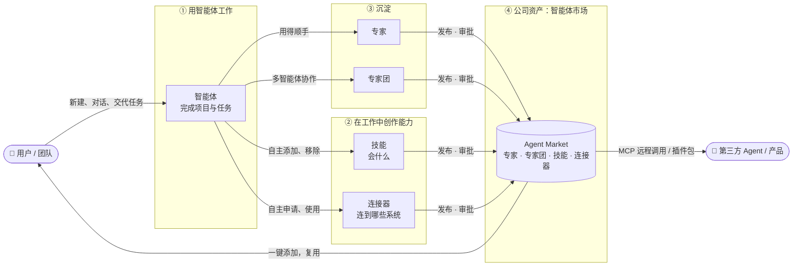

---

## 2. 核心概念

**智能体是唯一的基本单位。** 每个页面、每段对话都是一个智能体；不再区分会话、项目、任务。智能体本身就是记忆系统。专家和专家团是成熟的产物，但仍然是智能体。

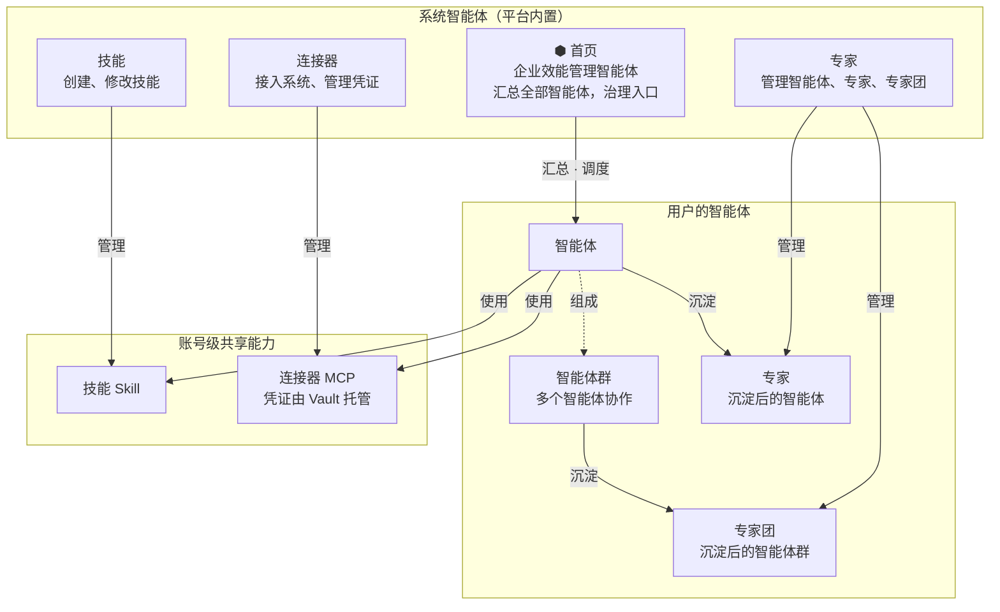

一个智能体由这些部分组成：

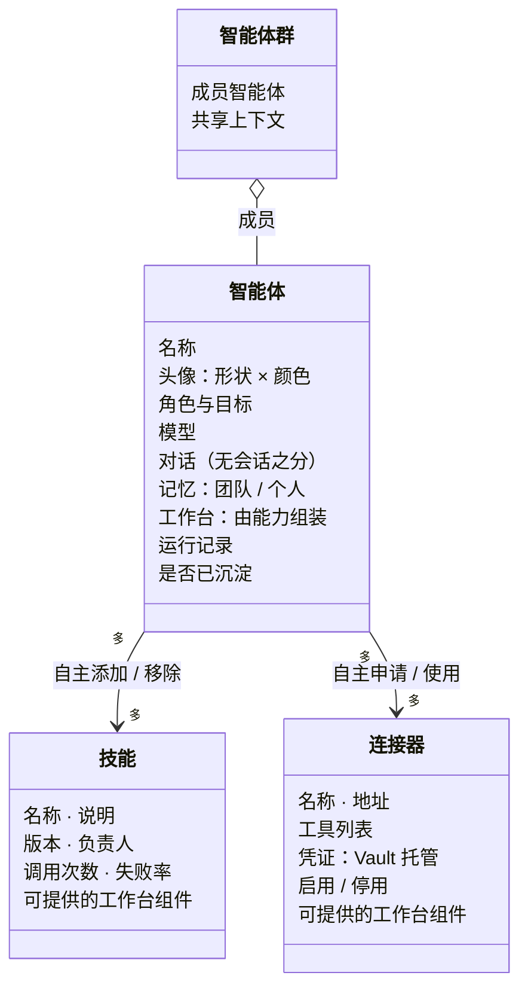

---

## 3. 系统架构

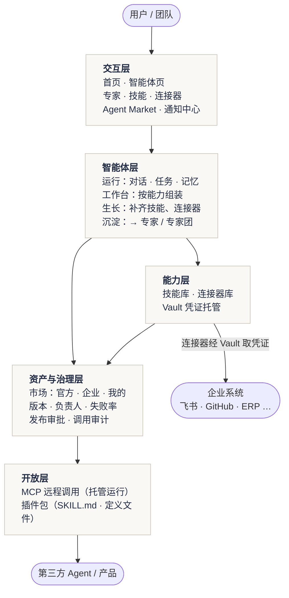

**工作台怎么生成**：智能体不生成代码，只生成一份声明式的布局描述，由固定的组件库渲染，保证视觉统一、可治理、可版本化。

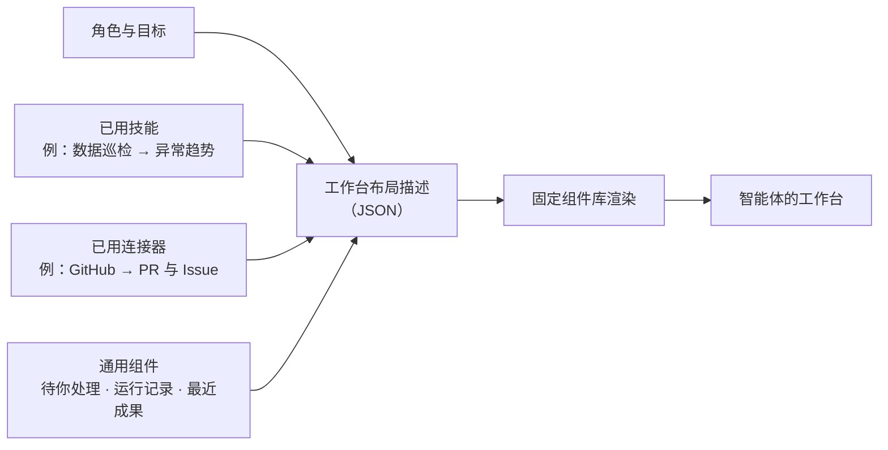

---

## 4. 智能体的生命周期

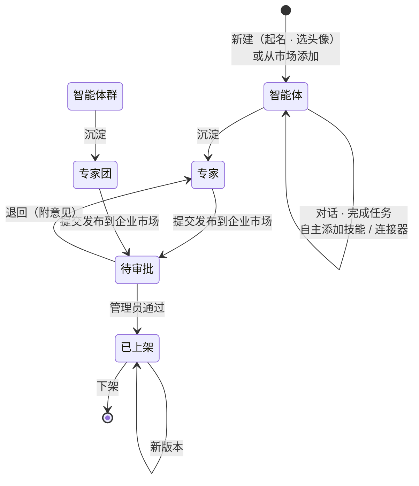

---

## 5. 关键流程

### 5.1 新建智能体并完成任务

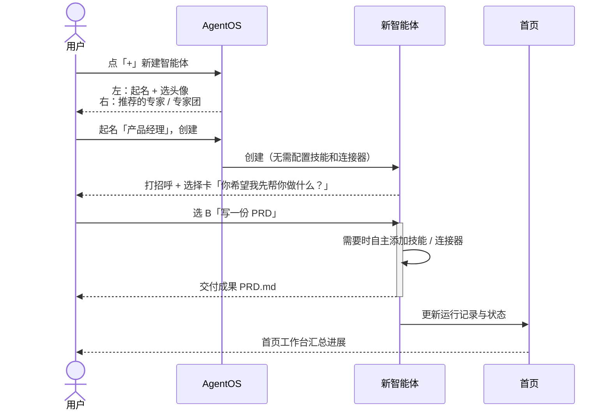

### 5.2 在对话中创作技能和连接器

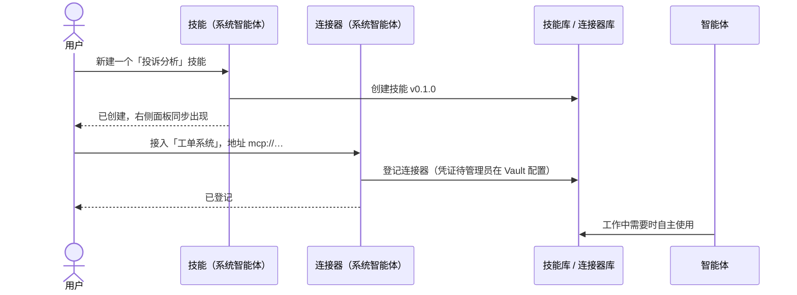

### 5.3 沉淀为专家并发布到市场

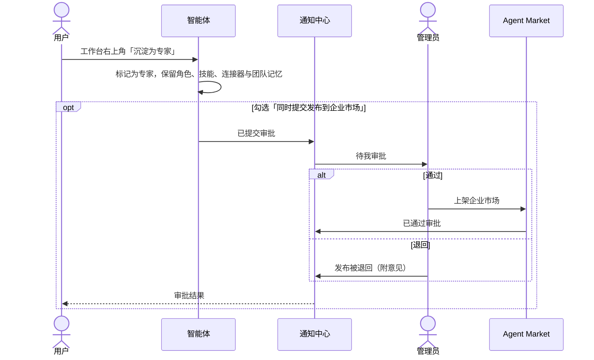

---

## 6. Agent Market 与第三方接入

**定义可移植，实例有状态。** 市场里上架的是无状态的「定义」；添加到 AgentOS 后才实例化为有记忆的智能体。第三方按「专家团」的思路使用定义，AgentOS 按「智能体」的思路运行实例，两者不冲突。

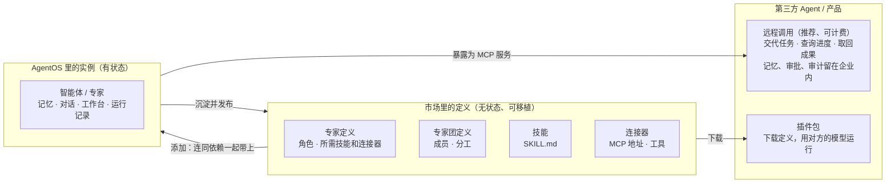

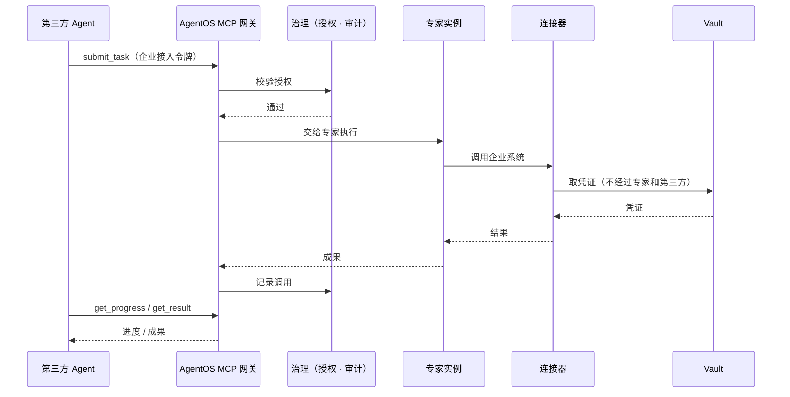

市场来源分三层：**官方**（AgentOS 预置）、**企业**（同事发布、管理员审批）、**我的**（个人私有）。整个市场本身也是一个 MCP 插件，第三方 Agent 可以在对话里搜索、添加和调用市场内容。

---

## 7. 界面结构

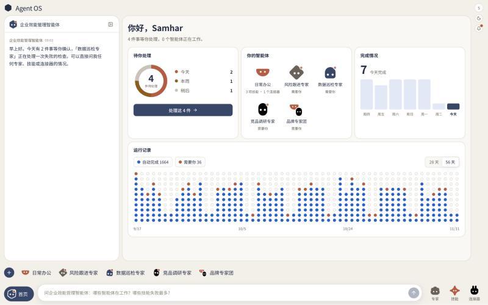

| 区域 | 内容 |
|---|---|
| 顶部 | 仅首页显示 Logo 与 Agent OS；其他页面面板直接到顶，左上角是当前智能体的头像 |
| 面板 | 左：当前智能体的对话（可收起）；右：工作台，系统智能体则为管理面板 |
| 智能体栏 | 「+」新建智能体；其他智能体为头像 + 名字，当前对话的为深色胶囊 |
| 输入行 | 左：首页；中：输入框；右：专家 · 技能 · 连接器 |
| 右侧窄栏 | 头像（菜单里有「市场」）· 亮暗切换 · 通知 |

- 首页与专家、技能、连接器四个按钮：未选中时头像在上、名字在下；选中时为深色胶囊。
- 系统智能体用专属头像形状：首页是六边形，专家是团队，技能是星芒，连接器是插头。

---

## 8. 名称对照

界面与对外材料使用中文名称；代码与数据结构沿用 bot / skill / mcp。

| 对外名称 | 内部概念 | 说明 |
|---|---|---|
| 智能体 | Bot（未沉淀） | 完成项目和任务，在工作中自主添加、移除技能和连接器 |
| 智能体群 | Bot 群聊（未沉淀） | 多个智能体协作 |
| 专家 / 专家团 | 已沉淀的 Bot / 群聊 | 成熟、可复用，可发布到企业市场 |
| 首页 | 主 Bot（企业效能管理智能体） | 汇总全部智能体，治理入口 |
| 专家 / 技能 / 连接器 | 系统 Bot | 左边对话、右边管理面板 |
| 技能 | Skill | 智能体「会什么」 |
| 连接器 | MCP | 智能体「连到哪些系统」 |
| 工作台 | Dashboard | 由角色与能力组装 |
| 市场 | Agent Market | 公司的智能体资产 |

---

更多设计细节见 [产品设计 v0.3](PRODUCT_DESIGN_v0.3.md)。当前代码为前端交互原型：智能体回复为模拟，尚未接入模型、真实 MCP 与后端。
